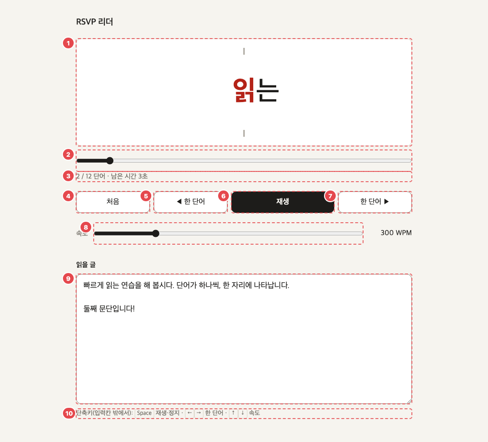

# RSVP_MAIN_01 · RSVP 리더

| 화면ID | 화면명 | 경로 | 버전 | 수정일 | 이미지 출처 |
|---|---|---|---|---|---|
| RSVP_MAIN_01 | RSVP 리더 | `/` | v0.4 | 2026-11-12 | 실제 화면 |

**한 줄 목표**: 사용자가 글을 붙여넣으면 한 자리에서 단어가 하나씩 바뀌어 나타나고 사용자는 원하는 속도로 읽는다.

## 화면

와이어프레임 (데스크톱 기준. 모바일도 같은 순서이고 480px 이하에서는 ⑤·⑦ 버튼이 ◀·▶ 기호만 보인다)

```
┌──────────────────────────────────────────────┐
│ RSVP 리더                                     │
│                                              │
│ ┌──────────────────────────────────────────┐ │
│ │                    ▼                     │ │
│ │              읽을 단어                    │ │  ① 단어 표시 영역
│ │                    ▲                     │ │
│ └──────────────────────────────────────────┘ │
│ ━━━━━━━━━━━━━━●─────────────────────────── ② │  ② 진행 막대
│ 12 / 340 단어 · 남은 시간 1분 05초         ③  │  ③ 진행 글
│                                              │
│ [처음] [◀ 한 단어] [  재생  ] [한 단어 ▶]   ④~⑦ │
│ 속도 ━━━━━●━━━━━ 300 WPM                  ⑧  │
│                                              │
│ ┌ 읽을 글 ─────────────────────────────────┐ │
│ │ 여기에 글을 붙여넣으세요              ⑨  │ │
│ └──────────────────────────────────────────┘ │
│ 단축키: Space 재생/정지 · ←→ 한 단어 · ↑↓ 속도  │
└──────────────────────────────────────────────┘
```

실제 화면 (번호 = Description 번호): 

## Description

| # | 요소 | 기능 | 동작 (누르면) | 상태 | 예외·정책 |
|---|---|---|---|---|---|
| 1 | 단어 표시 영역 | 지금 단어를 크게 보여 준다. 단어 전체를 영역 가운데에 두고, 단어마다 글자 하나를 강조색으로 칠한다. 강조 글자는 앞에서 35% 지점(올림)이고, 문장부호도 글자 수에 센다. 한 글자 단어는 첫 글자다 | 누르면 재생/일시정지 (⑥과 같음) | 빈: "아래에 글을 붙여넣으세요", 비활성, 눈금 숨김 · 대기: 현재 단어 · 재생: 단어가 바뀜 · 끝: "다 읽었어요", 눈금 숨김 | 단어가 영역 폭을 넘으면 글자 크기를 줄여 맞춘다(기본 크기의 30%까지). 그래도 넘치면 양쪽을 같은 만큼 자른다. 위아래 눈금은 영역의 가운데를 표시한다 |
| 2 | 진행 막대 | 전체 중 지금 위치 | 끌거나 누르면 그 위치로 이동한다. 재생 중이면 계속 재생 | 빈: 비활성 · 평소: 위치 표시 | 키보드 조작은 범위 입력(슬라이더) 기본 동작을 따른다. 눌리는 높이 44px |
| 3 | 진행 글 | 현재 단어 번호 / 전체 단어 수 · 남은 시간 | 없음 | 빈: "0 / 0 단어" · 평소: 숫자 표시 | 남은 시간은 현재 속도와 남은 단어 수로 계산한다 |
| 4 | 처음 버튼 | 첫 단어로 이동 | 첫 단어로 가고 일시정지 | 빈: 비활성 | 이동한 단어를 화면 읽기 프로그램에 알린다 (⑤·⑦ 같음) |
| 5 | 이전 단어 | 이전 단어 | 한 단어 앞으로 가고 일시정지 | 빈·첫 단어: 비활성 | 첫 단어에 닿아 비활성이 되면 포커스를 ⑥으로 옮긴다 |
| 6 | 재생/일시정지 | 재생 시작·정지 | 재생 ↔ 일시정지. 끝까지 읽은 뒤 누르면 처음부터 다시 | 빈: 비활성 · 정지: "재생" · 재생 중: "일시정지" · 끝: "처음부터" | — |
| 7 | 다음 단어 | 다음 단어 | 한 단어 뒤로 가고 일시정지 | 빈·마지막 단어: 비활성 | 마지막 단어에 닿아 비활성이 되면 포커스를 ⑥으로 옮긴다 |
| 8 | 속도 조절 | 분당 단어 수(WPM). 100~1000, 25 단위, 기본 300 | 끌면 바로 적용한다. 재생 중이어도 멈추지 않고 지금 단어는 이미 보인 시간을 빼고 남은 만큼만 더 보여 준다 | 평소만 | 마침표·물음표·느낌표 뒤와 문단 끝에서는 2.5배, 쉼표·세미콜론·콜론 뒤에서는 2배, 12글자 넘는 긴 단어는 1.5배 오래 보여 준다. 배율은 겹치지 않고 이 순서로 하나만 적용한다 |
| 9 | 읽을 글 입력칸 | 원문을 붙여넣거나 쓴다 | 고치면 재생을 멈추고 첫 단어로 돌아간다 | 빈: 안내 문구 · 평소: 글 | 공백·줄바꿈 기준으로 단어를 나눈다. 한국어는 띄어쓰기 단위(어절)로 나뉜다. 글은 저장하지 않는다 |
| 10 | 단축키 안내 | 키보드 조작 방법 | 없음 | 평소만. 터치 화면에서는 숨김 | 단축키는 포커스가 페이지 바탕이나 읽기 영역(①~⑧)에 있을 때만 동작한다. 입력칸 쪽에서는 글자 입력과 스크롤이 우선이다 |

## 상태별 화면

| 상태 | 보이는 것 | 사용자가 할 수 있는 것 |
|---|---|---|
| 로딩 | 없음 (서버 통신 없음) | — |
| 실패 | 없음 (실패할 동작 없음) | — |
| 빈 | ①에 "아래에 글을 붙여넣으세요", ②·④~⑦ 비활성 | 글 입력, 속도 조절 |
| 끝 | ①에 "다 읽었어요", ⑥ 문구 "처음부터" | 처음부터 다시, 앞뒤 이동 |
| 권한 없음 | 없음 (로그인 없음) | — |

## 접근성

- 키보드 순서: ① 단어 표시 영역 → ② 진행 막대 → ④ → ⑤ → ⑥ → ⑦ → ⑧ 속도 → ⑨ 입력칸
- 단축키(입력칸 밖): Space 재생/일시정지, ← → 한 단어 이동, ↑ ↓ 속도 ±25. 버튼 위에서 Space는 그 버튼을 누르고 슬라이더 위에서 화살표는 슬라이더를 움직인다
- 스크린 리더 라벨: ① 상태에 따라 "재생"·"일시정지"·"처음부터 다시 읽기", ⑤ "이전 단어", ⑦ "다음 단어", ② "읽은 위치"(값: "n / 전체 단어"), ⑧ "읽기 속도(분당 단어 수)"(값: "분당 n단어"), ⑨ "읽을 글"
- 알림(스크린 리더): 재생 중에는 단어를 읽어 주지 않는다. 재생 시작 "재생", 일시정지 "일시정지: 단어", 이동 "단어 (n / 전체)", 끝 "다 읽었어요"
- 포커스 표시: 모든 조작 요소에 2px 테두리 링
- 대비: 본문 글자 WCAG AA(4.5:1) 이상, 강조 글자도 배경 대비 4.5:1 이상. 입력칸·버튼 테두리는 3:1 이상

## 의문·미해결 (User Gate 후보)

- [x] 사이트 이름은 "RSVP 리더"로 정했다 (2026-11-12 사용자 결정)
- [x] 글은 저장하지 않는다. 새로고침하면 사라진다 (2026-11-12 사용자 결정)
- [x] 단어는 강조 글자 기준이 아니라 단어 전체를 가운데에 둔다 (2026-11-13 사용자 결정)
- [x] 강조 글자 위치와 표시 시간 배율은 참고 사이트(gamebob.dev RSVP 속독기)와 같게 맞춘다 (2026-11-13 사용자 결정)

구현 위치: `index.html`, `src/rsvp.js`(단어 나누기·고정 글자·표시 시간 계산), `src/app.js`(화면 동작), `src/style.css`
